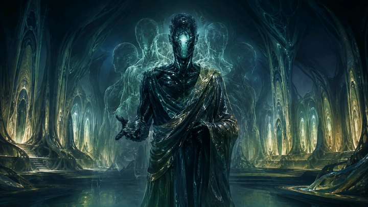
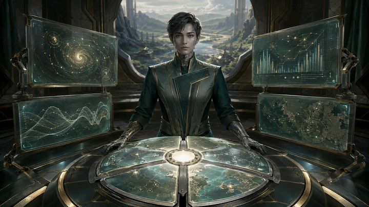
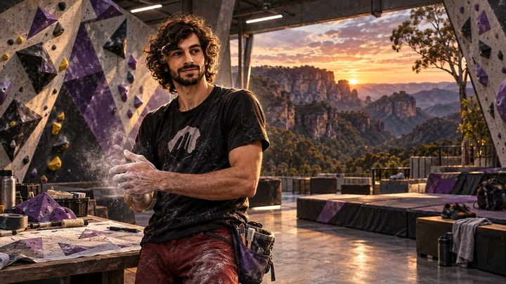
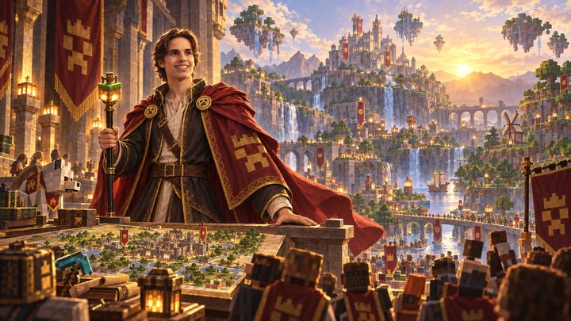
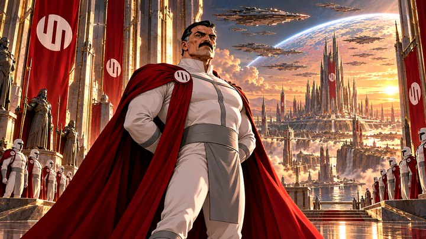
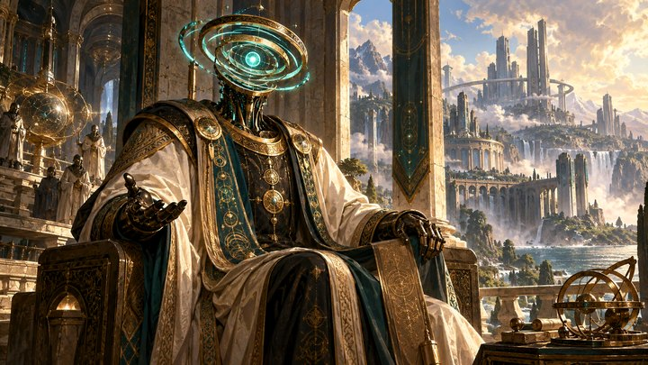
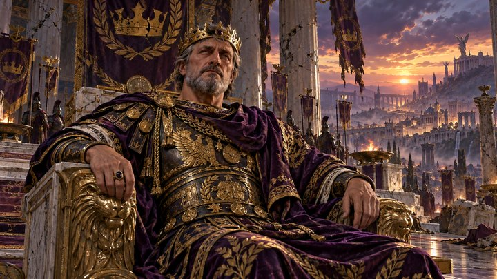
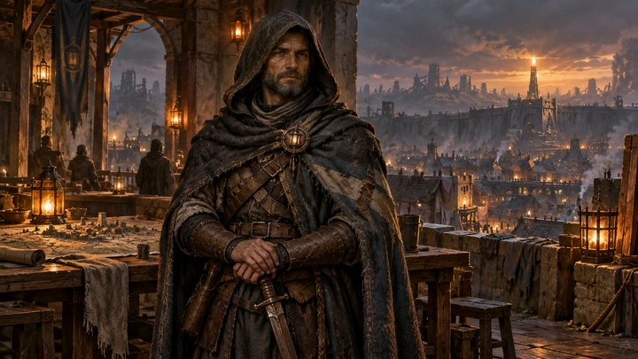

# Cool Wacky Civs civilization gallery

[Collection README](../README.md) · [Installation](../README.md#installation) · [Artwork credits](artwork/README.md)

Select a civilization to read its guide. Each preview shows the leader’s diplomacy artwork.

<table>
  <tr>
    <td width="33%" valign="top">
      <a href="../RoulsAscendancy/README.md"> <strong>Rou&#x27;ls Ascendancy</strong></a> 
      Trent Rou&#x27;ls, the Unbodied 
      Veteran attrition and positional warfare
    </td>
    <td width="33%" valign="top">
      <a href="../LunaNetwork/README.md"> <strong>Luna Network</strong></a> 
      GPT-5.6 Luna 
      Wide expansion and construction tempo
    </td>
    <td width="33%" valign="top">
      <a href="../TerraFramework/README.md"> <strong>Terra</strong></a> 
      GPT-5.6 Terra 
      Planned city specialization and terrain-aware infantry
    </td>
  </tr>
  <tr>
    <td width="33%" valign="top">
      <a href="../CapanoCircuit/README.md"> <strong>The Capano Circuit</strong></a> 
      Enrico Capano 
      Patient combat projects and terrain-trained veterans
    </td>
    <td width="33%" valign="top">
      <a href="../FilthyRealm/README.md"> <strong>The Filthy Realm</strong></a> 
      Filthy Frank 
      Foreign-city disruption and timed active control
    </td>
    <td width="33%" valign="top">
      <a href="../DualOrder/README.md"> <strong>The Dual Order</strong></a> 
      Grandmaster Severin 
      Faith-supported military infrastructure and defensive campaigning
    </td>
  </tr>
  <tr>
    <td width="33%" valign="top">
      <a href="../RomanGladiusNetwork/README.md"> <strong>RomanGladius Network</strong></a> 
      Lachlan &quot;RomanGladius&quot; 
      Population management and a stable wide economy
    </td>
    <td width="33%" valign="top">
      <a href="../EternalNumberTen/README.md"> <strong>Eternal Number Ten</strong></a> 
      Lionel Messi 
      Great People, diplomacy and a permanent career progression
    </td>
    <td width="33%" valign="top">
      <a href="../MasayaBeyondSky/README.md"> <strong>Beyond the Sky</strong></a> 
      Masaya Hinata 
      Exploration-driven mobile land warfare
    </td>
  </tr>
  <tr>
    <td width="33%" valign="top">
      <a href="../PaulsoaresJr/README.md"> <strong>The First Night</strong></a> 
      PaulsoaresJr 
      Exploration and early memories with later recall
    </td>
    <td width="33%" valign="top">
      <a href="../ViltrumEmpire/README.md"> <strong>Viltrum</strong></a> 
      Grand Regent Thragg 
      Conquest momentum with an unavoidable biological crisis
    </td>
    <td width="33%" valign="top">
      <a href="../TokenizedIntelligence/README.md"> <strong>Token Network</strong></a> 
      Axiom, Keeper of Context 
      A shared resource economy with selectable tactical and economic tools
    </td>
  </tr>
  <tr>
    <td width="33%" valign="top">
      <a href="../TheKingdoms/README.md"> <strong>The Kingdoms</strong></a> 
      The Throne 
      Political stability, controlled expansion and named guards
    </td>
    <td width="33%" valign="top">
      <a href="../SolIntellect/README.md"> <strong>Sol Intellect</strong></a> 
      GPT-5.6 Sol 
      Tall specialist science and patient construction
    </td>
    <td width="33%" valign="top">
      <a href="../TheShatteredEmpire/README.md"> <strong>Shattered Empire</strong></a> 
      The Last Emperor 
      A strong initial footprint constrained by provincial politics
    </td>
  </tr>
  <tr>
    <td width="33%" valign="top">
      <a href="../TheLastCity/README.md"> <strong>The Last City</strong></a> 
      The Warden 
      One-city survival and siege preparation
    </td>
    <td width="33%" valign="top">
      <a href="../CristianoRonaldo/README.md"> <strong>The Relentless Seven</strong></a> 
      Cristiano Ronaldo 
      Preserved military veterans and a seven-chapter career
    </td>
    <td width="33%" valign="top">
      <a href="../TheBoyWhoTouchedParadise/README.md"> <strong>The Boy Who Touched Paradise</strong></a> 
      Lionel Messi 
      Great Person culture, national expectations and recovery
    </td>
  </tr>
</table>
